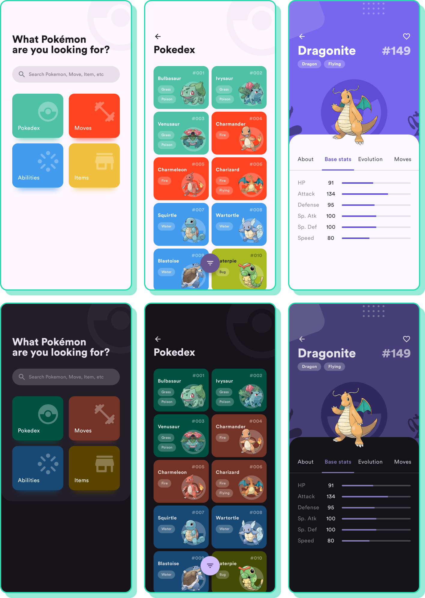

# Compose Pokedexer


A **Kotlin Multiplatform** Pokédex app with native **Android (Jetpack Compose)** and **iOS (SwiftUI)** frontends sharing a common data layer, powered by the [PokeAPI GraphQL API](https://pokeapi.co/docs/graphql#v1beta2).

Adapted from the original [compose-pokedex](https://github.com/zsoltk/compose-pokedex) project.

## Features

- Pokédex grid with filters for generation, Pokémon type, and favorites
- Pokémon detail screens with tabs for about, base stats, evolution chains, moves, and abilities
- Dedicated catalogs for moves, abilities, and items
- Interactive type-matchup chart
- Unified search across Pokémon, moves, and items
- Dynamic light and dark theming seeded from each Pokémon's primary type

## Notable Technical Choices

- **KMP `:shared` module**: Room database, Apollo GraphQL client, data models, and repositories shared between Android and iOS
- **Jetpack Compose Navigation 3**: `NavDisplay` with `rememberNavBackStack` and type-safe serializable routes
- **Metro DI**: Dependency injection with assisted injection for ViewModels requiring runtime parameters
- **SKIE**: Kotlin `Flow` to Swift `AsyncSequence` interop for iOS
- **RuntimeShader**: Pager color transitions on Android 13+ (API 33+)
- **Material Kolor**: Seed-based dynamic color generation across platforms
- **Coil**: Image loading with animated GIF support
- **DataStore**: User preferences (favorites) storage

## Screenshots



## Building

### Android

```bash
./gradlew assembleDebug
```

### iOS

Open `iosApp/PokedexerApp.xcodeproj` in Xcode and build for a simulator or device (iOS 18.0+).

The shared KMP framework is built automatically by the Xcode build phase, or manually:

```bash
./gradlew :shared:linkReleaseFrameworkIosSimulatorArm64
```

## Original design

Adapted from [Pokedex App design](https://dribbble.com/shots/6545819-Pokedex-App) by [Saepul Nahwan](https://dribbble.com/saepulnahwan23).

Notable additions:
- Dark theme
- Designs for all tabs on details screen
- Designs for Move, Abilities, and Items screens
- Designs for search

## Disclaimer

This sample app is not affiliated with or endorsed by Nintendo, Game Freak, or The Pokémon Company. Character names and game data are trademarks of their respective owners and are used here as a fair-use reference.

## License

All code is available under the MIT license. See [LICENSE](LICENSE).
